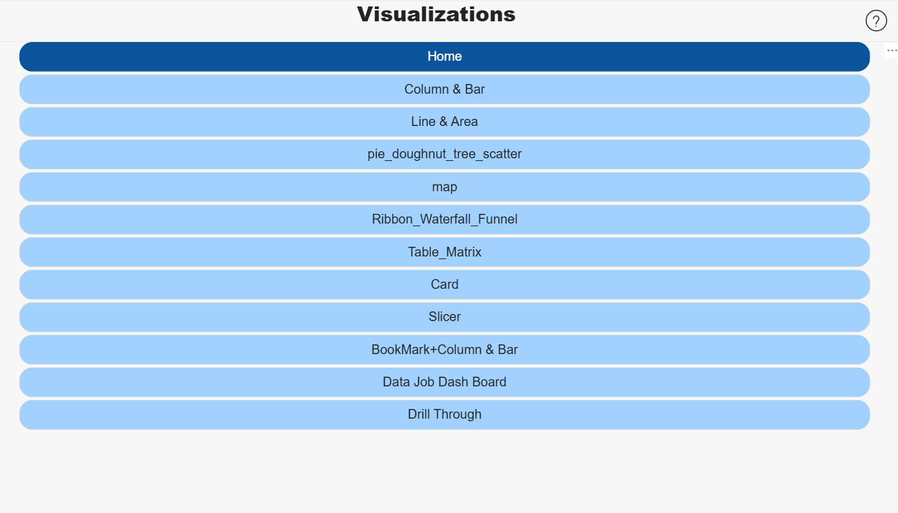
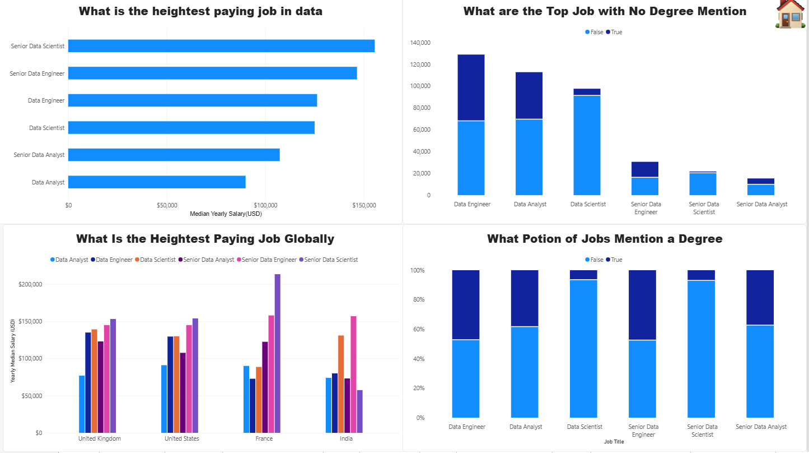
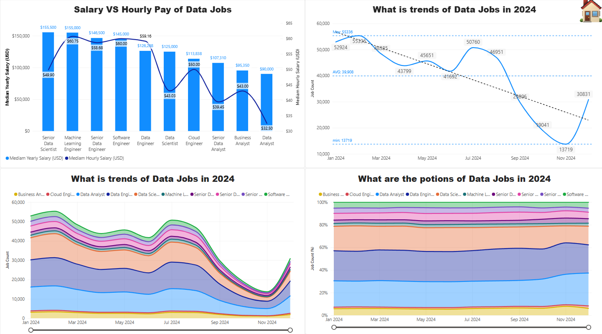
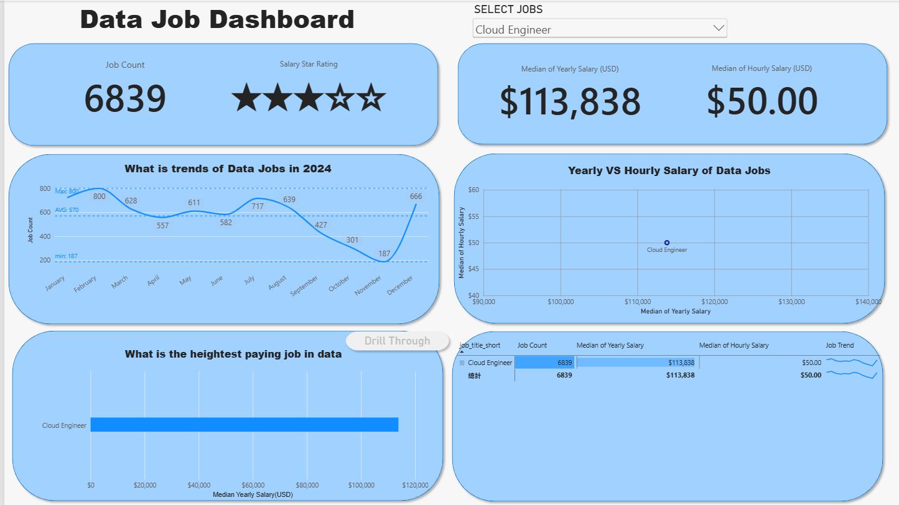
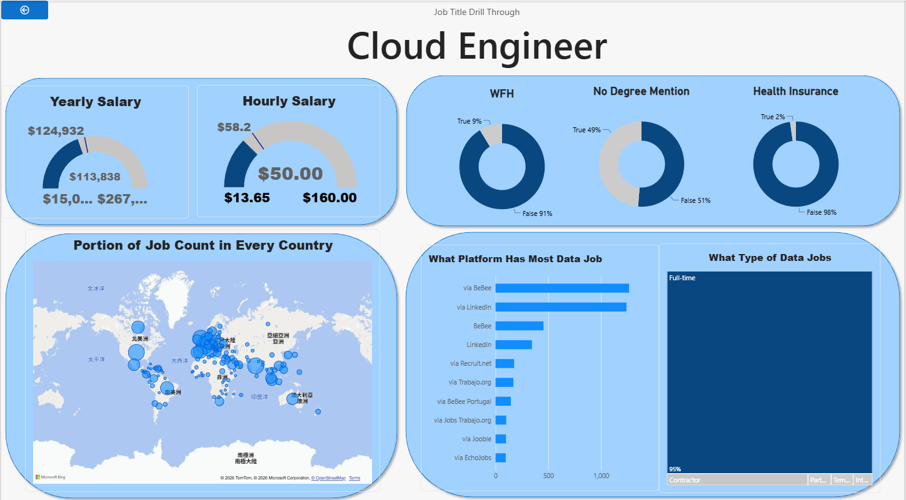

# Power BI Demonstration of Data Job Market (2024)

## 專案概述 (Project Overview)

本專案聚焦於 **2024 年資料相關職位（Data Jobs）市場趨勢與薪資結構分析**，透過三份 Power BI 檔案呈現 從 **「視覺化元件與互動設計」、「互動式儀表板與跨頁參數傳遞(向下鑽研)」到 「互動式儀表板與Field」** 的完整演進。

在設計過程中，除了確保圖表正確傳達數據訊號外，亦著重於**使用者體驗（UX）與互動規劃**——讓求職者或招募端能透過切片器（Slicer）、按鈕（Button）、頁面導覽（Page Navigator）與向下鑽研（Drill Through），從宏觀市場快速下探至特定職位的細節資訊。

---

### 📊 1. 視覺化元件與互動設計練習 (`Visualization Data Job.pbix`)

#### 專案目標與設計重點
* **圖表選擇與視覺化元件**：依據資料維度、分布型態與比較目的，選擇合適圖表，避免單純為追求視覺華麗而犧牲可讀性。
* **互動式導覽與資料篩選**：整合 **Slicer（篩選器）**、**Button（客製化按鈕）** 與 **Page Navigator（頁面導覽器）**，建立清晰的頁面切換與篩選邏輯，讓使用者能自主探索資料。

#### 核心技能展現
* 視覺化圖表選型與版面配置（Visual Encoding & Layout Design）
* 動態篩選與互動控制（Slicers, Buttons & Page Navigator）

#### 視覺化元件應用與實務判準

| 圖表類型 | 適用分析情境 | 實務設計重點與注意事項 |
| :--- | :--- | :--- |
| **Column & Bar Chart** | 跨類別數值比較、排名或離散維度對比 | 群組長條圖（Clustered）適合直接比較各組數值；堆疊長條圖（Stacked）重點在總量與結構組成。使用圖例（Legend）分組時需留意類別數量，避免圖例過多造成視覺雜訊。 |
| **Line & Area Chart** | 時間趨勢追蹤、週期變化觀察 | 適用於連續時間軸（如年月、季度），能清楚呈現成長斜率與轉折點；面積圖（Area）更強調累積量感，多系列重疊時需注意透明度與遮蔽問題。 |
| **Pie & Donut Chart** | 整體中的占比結構（Part-to-Whole） | 僅建議在 **類別少（通常不超過 4–5 項）** 且各部分差異明顯時使用；若要精準比較大小，優先改用橫條圖。 |
| **Map** | 地理空間分布與區域差異 | 適合呈現國家、地區或城市層級的職缺/薪資分布，透過圓圈大小或色彩深淺反映區域差異|
| **Table & Matrix** | 明細資料查詢、多維度交叉檢視 | **Table** 適合逐筆明細與多欄位檢視；**Matrix** 適合行×列交叉彙總與階層展開，搭配條件式格式或小計可大幅提升查閱效率。 |
| **Card** | 核心指標（KPI）摘要呈現 | 放置於報表視覺焦點處，呈現總職缺數、薪資中位數/平均數等關鍵數字，建議搭配清楚的單位標示與篩選狀態說明。 |

#### 報表畫面預覽

---

### 📈 2. 資料職位求職洞察儀表板 (`Dashboard.pbix`)

#### 商業情境與分析目的
求職者在評估資料領域職位時，常面臨「只看平均薪資容易被極端值誤導」、「不同職能與地區落差大」等資訊不對稱問題。本儀表板旨在提供一站式的互動檢視介面，協助使用者快速掌握：
* 各類資料職位的**薪資水準與分布差異**
* 不同維度下的**市場需求與職缺量能**
* **Drill Through（向下鑽研）分析**：當使用者鎖定特定職位或條件後，可直接鑽研至該職位的細部指標與對應資訊，實現「總覽 → 聚焦 → 詳細資訊」的分析。

#### 核心技能展現
* 互動式商業儀表板設計（Interactive BI Dashboard）
* 跨頁參數傳遞與向下鑽研（Drill Through Design）
* 面向決策/求職者的資訊架構（Information Hierarchy）

#### 儀表板畫面預覽

### 🎯 3. 技能組合、動態維度與稅後薪資模擬 (`Measure+parameter.pbix`)

#### 商業情境與分析目的
除了職稱與地區外，求職者在做職涯與薪資決策時，更需要回答兩個進階問題：**「不同技能組合對應到多少職缺與薪資水準？」**以及**「在不同假設稅率下，實際落袋的稅後所得是多少？」**

本儀表板透過參數化與明確量值設計，讓使用者能即時調整分析維度與假設條件：
* **技能要求與市場供需對照**：檢視各類資料職位常見的技能組合（例如資料分析師常見的 SQL、Excel、Power BI，或進階的 Python 與資料工程能力），對照其職缺數量與薪資表現。
* **稅率假設與淨所得試算（Numeric Range）**：透過數值範圍參數調整假設稅率，動態計算扣除稅額後的預估所得，協助評估不同薪資級距的實質差異。
* **動態切換 X 軸維度（Field Parameter）**：讓使用者在單一視覺物件上自由切換 X 軸分析維度（如職位、技能或地區），減少重複建置多張相似圖表的維護成本。

#### 核心技能展現
* **Explicit Measures（明確量值）**：將核心指標與稅後所得計算邏輯封裝於量值中，確保跨圖表計算口徑一致。
* **Field Parameters（欄位參數）**：實現動態切換圖表維度，提升儀表板探索彈性。
* **Numeric Range Parameters（數值範圍參數）**：支援稅率等假設變數的互動模擬（What-If Analysis）。

#### 儀表板畫面預覽

---
## Reference
https://www.youtube.com/watch?v=FwjaHCVNBWA